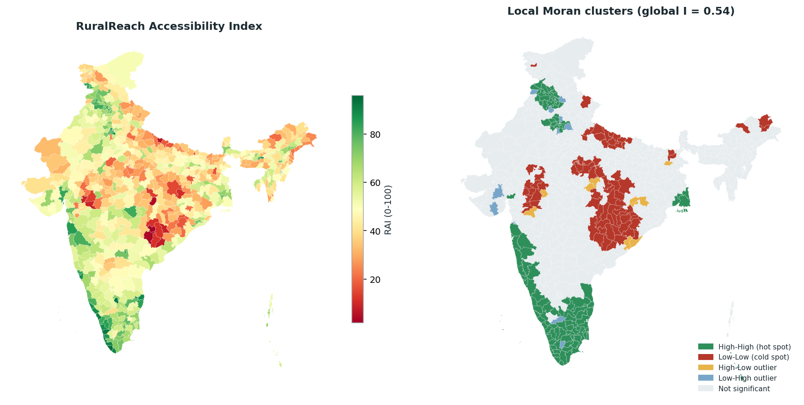
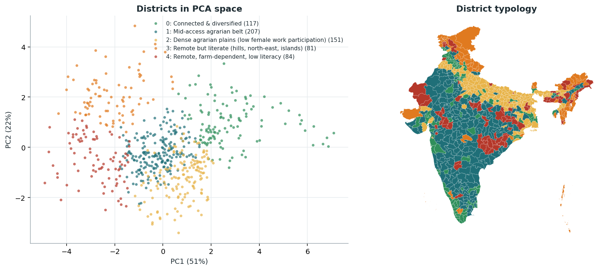
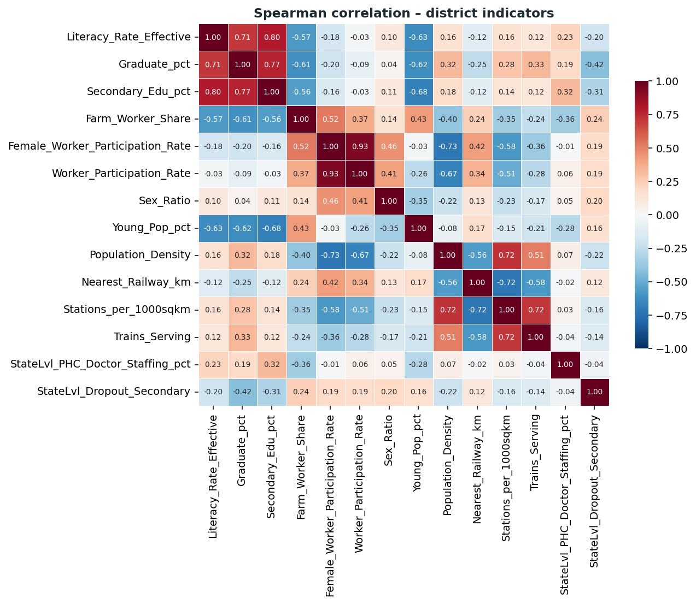
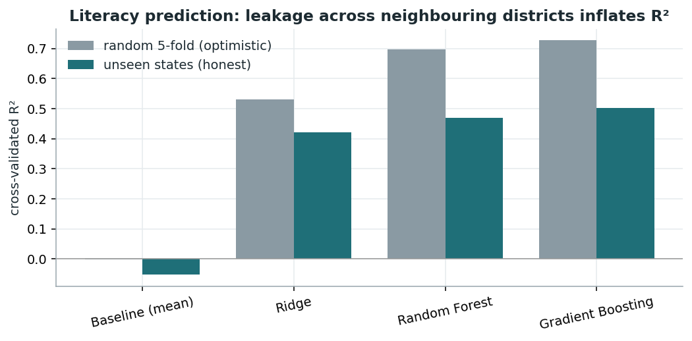

# RuralReach – Rural Service Accessibility Intelligence System

*Fundamentals of Data Science project.* A reproducible pipeline that integrates nine public datasets into **one validated, district-level master table (640 Census-2011 districts)**, builds a transparent **Accessibility Index**, finds **priority districts, spatial hot/cold spots and district typologies**, and publishes everything as an **interactive dashboard**.

### 🌐 Live dashboard: **https://siddhu2606.github.io/RuralReach/**

[](https://siddhu2606.github.io/RuralReach/)

---

## Why this matters
Policy discussion about "rural India" usually stops at state averages, but about half of the variance in literacy, farm dependence and rail access sits **inside** states. RuralReach scores every district on education, transport, health and livelihood access so that gaps can be located – and prioritised – at the level where schemes are actually delivered.

## Headline findings
| | |
|---|---|
| **146 districts (~188 M people)** | are *critical-gap*: farm-dependent **and** in the bottom quartile of access – concentrated in Madhya Pradesh (28), Uttar Pradesh (23), Odisha (15), Chhattisgarh (15), Bihar (11), Jharkhand (10) |
| **Lowest state (pop-weighted)** | Chhattisgarh (RAI 30) · Arunachal Pradesh · Meghalaya · Madhya Pradesh · Uttar Pradesh. Highest: Kerala (86), Goa, Delhi |
| **Deprivation is spatially clustered** | Moran's I = **0.54** (p = 0.001). A contiguous cold spot spans Chhattisgarh–Odisha–Jharkhand–eastern MP |
| **87 districts (42 M people)** | have no railway station within 50 km of their centre |
| **Rail access ≠ social development** | districts with a station have the *same* median literacy (72.0 vs 72.4 %, Mann-Whitney p = 0.41) – so a one-dimensional proxy would mislead |
| **Index is robust** | rank correlation with equal weights 0.99, PCA weights 0.95, 2,000 random weightings median 0.90 |
| **Honest ML** | structure-only models explain ~50 % of literacy in *unseen states* (random CV claims 0.73 – leakage between neighbouring districts) |

## Repository tour
```
raw/            original files (never edited) + DataMeet station coordinates
extracted/      unzipped shapefile & railway timetable (git-ignored, recreated by notebook 01)
src/            the pipeline as annotated scripts (also the source of the notebooks)
notebooks/      01 audit · 02 build master · 03 EDA · 04 index, clusters, spatial stats, ML  (executed, with outputs)
processed/      audit tables, match-coverage, validation checks, missingness, parent map, results_summary.json
final/          RuralReach_Master.csv (+ base, data dictionary, district GeoPackage)
docs/           dashboard (GitHub Pages) + DATA_DICTIONARY.md
assets/         figures
```
Re-run everything with `pip install -r requirements.txt && python run_all.py`.

## Data integration (follows the *Dataset Integration Guide*)
**Rule followed:** audit first, then reshape every source to one-row-per-district, then **left-join onto the Census**; missing ≠ 0; every decision documented.

| Source | Role | What was done |
|---|---|---|
| India Census 2011 (640 districts) | **Master** | clean keys, derived rates (literacy, sex ratio, worker shares, density, …); internal-consistency checks pass |
| District shapefile (`archive.zip`, 693 polygons) | Geometry | Exact **2011-population anchor** matches 630 districts; 10 more via a documented parent map (9 Telangana, Jaintia Hills); 33 post-2011 districts folded back into their 2011 parent; dissolved → one polygon per Census district; area on an equal-area projection |
| District centroids | Coordinates | 590/594 rows matched (exact/fuzzy + a documented alias table, `src/district_aliases.csv`); polygon-centroid fallback; median disagreement with polygon centroid 7 km |
| Railway timetable (`schedules.json.zip`, 417 k rows) | Transport | The timetable has **no coordinates** → joined to the open DataMeet station table (96.6 % of codes found) → point-in-polygon → station count, trains serving, distance to nearest station |
| Commodity / mandi prices | Supporting | Unique markets per district (151 districts); **NaN elsewhere** (one-day, 16-state snapshot) |
| NREGA | Supporting | **ratios only** (new districts split old ones, so counts would be wrong): 451 of 640 districts matched |
| Literacy Data 2011 | Validation | r = 0.99 with Census-derived literacy; adds the official 7+ definition as one column |
| Dropout 2012-15, PHC doctors 2017 | State context | cleaned (`NR` → NaN), attached as `StateLvl_*` columns so no one mistakes them for district data |
| hlpca-colnames | Metadata | not merged |

**Validation (all pass, `processed/validation_checks.csv`)** – 640 unique districts, no row multiplication, percentages in 0–100, no negative counts, coordinates inside India, every district has geometry, total area within 10 % of India's land area, Male+Female = Population, provenance period recorded for each block. Missingness per column: `processed/missing_values_by_column.csv`. Full column list: [`docs/DATA_DICTIONARY.md`](docs/DATA_DICTIONARY.md).

### ⚠ Honest limitations
* **No school-facility or district-level PHC/CHC data was supplied** (only a state-level doctor table and state dropout rates). Hence the *Health* pillar is **state-level** and there is no district school-infrastructure or digital pillar. These are flagged in the data (`StateLvl_`) and in the dashboard.
* The Census file has **no urban/rural split**; rurality is proxied by the share of farm workers.
* Census attributes are 2011; NREGA, mandi and railways are later undated snapshots – periods are recorded per block.
* Rail distances use district centroids (large districts → coarse); the timetable gives relative service, not frequency.
* Everything reported is an **association**, not a causal effect.

## Methods
1. **RuralReach Accessibility Index (0–100)** – indicators oriented to "higher = better", `log1p` for skewed counts, winsorised min-max (5th–95th pct), pillar mean, weighted sum: Education 0.30 (literacy, secondary %, graduates %) · Transport 0.30 (distance to station⁻¹, station density, trains) · Health 0.20 (state PHC staffing, doctors/100k) · Livelihood 0.20 (non-farm worker share). Missing indicators are skipped, not zeroed.
2. **Robustness** – equal / PCA / drop-one-pillar / 2,000 Dirichlet weightings.
3. **Priority groups** – rurality (farm share ≥ median) × access tier (RAI quartiles).
4. **Spatial statistics** – global & local Moran's I (8-nearest-neighbour weights, permutation tests) → hot/cold spots.
5. **Clustering** – K-Means (k = 5) on 8 standardised district features; seed stability ARI 0.97; agreement with Ward ARI 0.45 (soft boundaries; silhouette 0.22 – a continuum, so used as a typology, not "natural groups").
6. **ML** – Ridge / Random Forest / Gradient Boosting predicting literacy from non-education structure, evaluated with random K-fold **and** state-held-out GroupKFold; fold-wise permutation importance.

| District typology | Districts |
|---|---|
| Connected & diversified | 117 |
| Mid-access agrarian belt | 207 |
| Dense agrarian plains (low female work participation) | 151 |
| Remote but literate (hills, north-east, islands) | 81 |
| Remote, farm-dependent, low literacy | 84 |

<p align="center">
<br>
 
</p>

## Using the data
```python
import pandas as pd
df = pd.read_csv("final/RuralReach_Master.csv")          # one row per district, 95 columns
df.query("Priority_Group.str.startswith('1')").nsmallest(10, "Overall_Accessibility_Index")[["State_name", "District_name", "Overall_Accessibility_Index"]]
```
District polygons live separately in `final/RuralReach_Districts.gpkg` (join on `District_ID`).

## Data sources
Census of India 2011 · district boundary shapefile and centroid files (as supplied for the course) · Indian Railways timetable · [DataMeet railway stations](https://github.com/datameet/railways) (station coordinates) · MGNREGA district MIS · Agmarknet commodity prices (19 May 2025) · MoHFW PHC doctor requirement/position (2017) · UDISE dropout ratios 2012-15. Please check each source's licence before redistributing the raw files.
